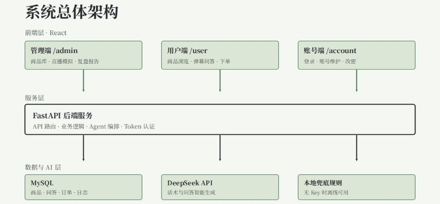
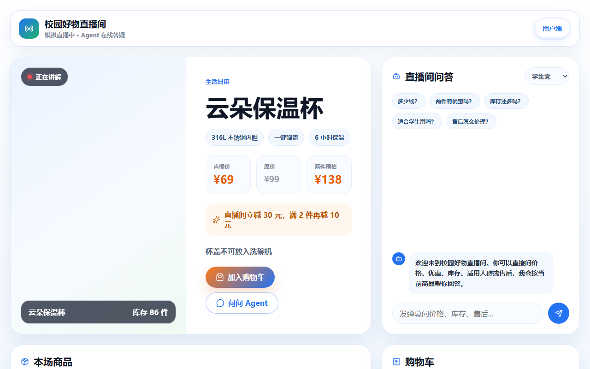
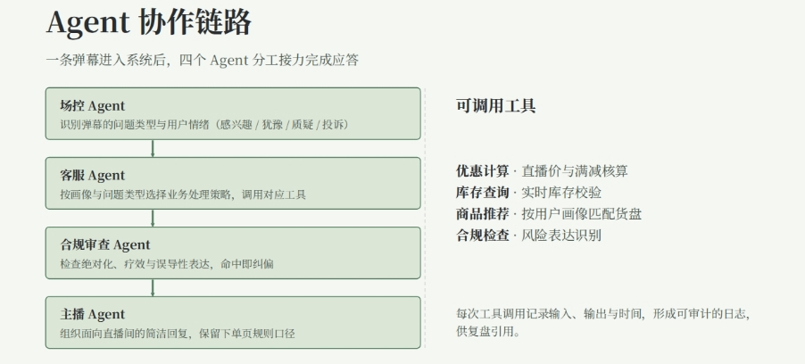

# 直播电商运营 Agent 工作台作品介绍

作品类型：校园模拟直播运营系统与 AI 辅助软件测试实践

编制日期：2026 年 10 月 30 日

本作品围绕直播运营中的商品管理、话术组织、观众问答与效果复盘，构建了用户端、管理端和账号端协同使用的运营工作台。项目将大语言模型内容生成与确定性的业务规则结合，同时将 AI 辅助用例设计和自动化回归测试用于开发过程，形成可操作、可追溯的课程实践成果。

## 一 项目详情及使用方式

### 项目背景与目标

在模拟直播场景中，主播需要同时讲解商品、回答价格和售后问题、处理促销规则并关注订单。依靠人工切换多个页面容易遗漏问题，单纯套用固定话术又难以适应不同商品和用户画像。本作品将这些操作整合到同一套业务系统，帮助使用者理解“商品上下文、业务工具、模型生成、过程记录、直播复盘”的完整链路。

### 功能与角色

| 使用角色 | 主要操作 |
| --- | --- |
| 主播与运营人员 | 维护商品和图片，选择讲解商品，生成话术，查看弹幕、订单、工具日志与复盘 |
| 模拟观众 | 浏览商品，选择用户画像，发送弹幕，咨询 Agent，加入购物车并模拟下单 |
| 账号管理人员 | 登录系统，查看或创建账号，修改密码 |

系统支持优惠计算、库存查询、商品推荐和合规规则检查；用户提问和订单进入后端后，管理端通过轮询更新显示。商品、账号、问答、订单、工具日志和复盘报告具备数据库存储结构，上传图片保存在后端目录。

### 使用步骤

1. 准备 Python、Node.js 和 MySQL，安装源码中的后端及前端依赖。
2. 创建 `live_agent` 数据库，将 `.env.example` 复制为 `.env`，填写运行环境的数据库连接和可选 DeepSeek 配置。
3. 在项目根目录运行 `python start-project.py`，或双击 `start-project.bat`。
4. 主播登录管理端，新增或选择商品，在直播模拟页面查看话术和互动信息。
5. 观众打开用户端，发送问题或模拟下单；主播查看实时弹幕与订单，再到复盘页面生成报告。

本机入口为：管理端 `http://127.0.0.1:5173/admin/login`，用户端 `http://127.0.0.1:5173/user`，账号端 `http://127.0.0.1:5173/account`。不同电脑协同时，应共同访问一套前后端服务和同一数据库；局域网访问需配置主机 IP、监听地址和跨域来源。

当前订单为模拟订单，未接入真实支付；库存扣减事务和跨设备音视频直播仍需进一步实现。摄像头演示采用同一浏览器环境的画面同步机制，不能据此视为已完成公网直播。

## 二 项目亮点

### 形成完整的直播运营流程

作品将商品录入、主播话术、观众问答、订单展示与复盘放在同一业务链路中。三个端共用后端数据，便于演示“观众提交问题或订单，主播查看并处理”的协同过程。

### 将模型表达与业务计算结合

价格、库存和促销问题先由后端规则与工具处理，再把商品资料、用户画像和工具结果交给 DeepSeek 组织回复。模型承担内容表达，规则承担可核对的业务处理，回复同时保留来源与工具轨迹。

### 保留可解释的角色和工具轨迹

界面展示场控、客服、合规审查和主播等角色分工，以及优惠计算、库存查询、推荐和合规检查的输入与输出。当前角色轨迹由代码组织，用于解释处理过程，并非多个独立模型自主协商。

### 兼顾模型能力与演示连续性

主播话术、商品草稿和用户问答优先调用模型；缺少配置或调用失败时使用本地备用规则，并显示来源。这样可以保留基本演示流程，也便于测试模型分支与备用分支。

### 将 AI 辅助测试融入迭代

开发过程中使用 Codex 协助分析需求、设计测试场景、生成和调整测试代码，并通过实际测试与页面检查确认修改。测试既覆盖业务接口，也覆盖模型请求格式、异常输入和备用回复机制。

## 三 AI 测试技术落地使用情况

### 落地方式

AI 辅助测试贯穿“需求拆分、用例设计、脚本编写、问题定位、修改后回归”的过程。根据直播业务，将普通咨询和异常合规问题整理为可重复执行的输入，通过 Pytest 和 FastAPI TestClient 检查接口状态、响应结构、工具日志及角色轨迹。AI 提供测试设计和代码辅助，最终结论以实际执行结果为依据。

### 已落地的测试场景

| 测试场景 | 实际落地方式与验证点 |
| --- | --- |
| 商品问题覆盖 | 对 10 个商品分别测试价格、库存规格、售后、异常合规 4 类问题，共 40 个参数化组合 |
| 模型调用契约 | 使用 monkeypatch 和模拟 HTTP 响应，检查 DeepSeek 请求、结构化话术和问答响应解析 |
| 本地备用分支 | 移除测试环境中的模型密钥，验证商品草稿、话术与问答仍返回稳定结构 |
| 输入和异常处理 | 检查非法商品资料、无效用户画像、不存在的商品、错误密码和未登录账号访问 |
| 图片上传 | 检查正常上传、非图片文件和伪造图片内容 |
| 数据与联动 | 检查商品增删、问答与工具日志保存、用户问题进入弹幕流、订单进入管理端读取接口 |
| 记录与维护 | 检查弹幕去重与排序、记录编号范围、复盘结构和启动日志轮转 |

### 本次复核结果

2026 年 10 月 30 日，在 Windows 本机的隔离源码副本中运行现有后端测试，结果为 **74 passed in 1.34s**。运行时未使用真实数据库连接或有效模型密钥，避免改变原有业务数据或产生模型调用费用。

验证命令的核心为 `python -B -m pytest backend/tests -q -p no:cacheprovider`。复核环境同时禁用了无关的 Pytest 插件自动加载，保留项目现有测试逻辑。

这些结果证明现有自动化测试用例在该环境通过。模型 Mock 验证的是请求与响应处理契约，不代表真实模型回答正确率；仓储测试使用 SQLite 内存数据库验证数据操作，不等同于真实 MySQL 并发或兼容性测试。项目尚未建立真实大模型的大样本质量评测、压力测试或生产级测试平台，因此不将“74 项通过”表述为线上系统的全面正确性保证。

## 四 项目涉及的关键技术

| 技术 | 在作品中的用途 |
| --- | --- |
| React 与 TypeScript | 构建用户端、管理端、账号端和类型化组件交互 |
| Vite 与 CSS | 本地开发、前端构建、页面布局和响应式展示 |
| FastAPI 与 Pydantic | 提供 HTTP 接口，定义并校验请求和响应数据 |
| DeepSeek 与 HTTPX | 按商品上下文生成话术、商品草稿和观众回复，解析结构化输出 |
| SQLAlchemy 与 PyMySQL | 定义数据库模型，封装 MySQL 数据读写 |
| MySQL | 保存商品、账号、问答、工具日志、订单和复盘报告 |
| PBKDF2 与 Token | 密码带盐哈希、登录状态识别和账号接口访问校验 |
| Pytest 与 TestClient | 参数化接口测试、异常路径验证和自动化回归 |
| monkeypatch 与 Mock | 隔离外部模型服务，验证生成分支与备用分支 |
| Git 与启动脚本 | 源码管理、固定端口检查、进程启动和日志轮转 |

数据库包含 `products`、`qa_logs`、`tool_logs`、`orders`、`review_reports`、`accounts` 六类核心表。图片文件保存在 `backend/uploads/products/`，数据库记录图片地址。

问答主要依据后端规则选择工具，再调用模型生成最终内容；复盘主要通过统计、排序和规则生成。当前尚未接入 LangGraph、WebSocket 或完整跨设备音视频传输。登录 Token 仍存于后端内存，公网应用还需完善会话有效期、业务接口权限和直播场次数据隔离。

## 五 项目相关图片

以下图示和界面截图来自本作品已有实践报告。图示用于说明架构和角色分工；截图展示当时的实际页面状态，不作为本次在线服务运行截图。

图 1 系统总体架构。React 前端提供三个应用入口，FastAPI 连接数据存储、模型服务和本地备用规则。

图 2 用户端直播间实际界面。包含当前商品、直播价、优惠规则、用户画像、弹幕问答和购物车入口；页面左侧为当时的直播展示区域。

图 3 Agent 角色与工具处理示意。展示场控、客服、合规与主播的功能分工；实际轨迹由后端业务代码构造，并非四个独立模型并行运行。

## 六 项目发表及获奖情况

本作品此前未正式发表，未获得相关奖项。

## 七 项目基础及优化说明

本作品根据直播电商运营场景需求开展设计与实现，未以他人完整项目为基础进行二次开发。React、FastAPI、SQLAlchemy 等属于所使用的通用开源框架和依赖。开发过程中使用了 AI 辅助设计、编码、测试与问题定位。

作品在自身原型基础上进行了持续迭代，主要优化包括：

1. 从单页模拟界面扩展为用户端、管理端与账号端，并按功能拆分管理页面。
2. 从固定模板和前端模拟数据，演进为 FastAPI 接口与 DeepSeek 生成能力。
3. 从运行内存保存商品和日志，扩展为数据库持久化，保存问答、订单与复盘。
4. 增加本地图片上传、AI 辅助填写商品资料、商品删除和用户下单联动。
5. 修正弹幕排序、重复提交、内容溢出与滚动问题，并将管理端轮询间隔调整为约 8 秒。
6. 补充账号登录、密码哈希、启动端口检查与日志轮转。
7. 将自动化测试扩展到 10 个商品的核心问题组合，并补充模型 Mock、非法输入和数据保存检查。

后续将优先完善后端业务权限、订单金额与库存一致性、会话管理和场次隔离，再根据实际需要升级实时推送与跨设备直播能力。
